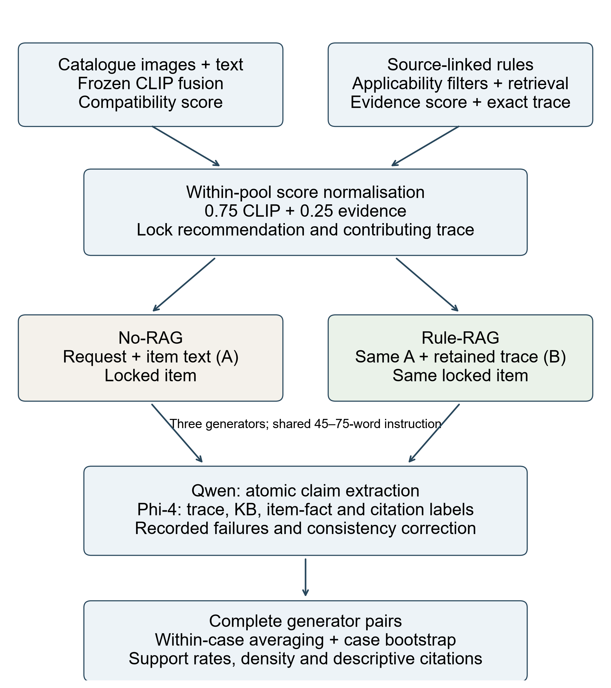

# Chapter 3

# Methodology

## 3.1 Introduction

This chapter describes the offline experiment used to connect multimodal recommendation to a saved symbolic trace and to assess the explanations generated from it. Data preparation, representations, candidate pools and rules were fixed before the confirmatory run. The recommendation stage then locked an item and its contributing rule trace for each case. Paired explanations of that item were generated with and without access to the trace. Ranking effectiveness, rule participation and explanation support were assessed separately.

The design follows a paired-comparison principle. For each explanation case, common context A contained the request, query-item text and identity, and locked recommended-item text and identity. Exact trace B contained the eligible rules, up to the configured maximum of five, that contributed to the frozen evidence score. The No-RAG generator received A alone. The Rule-RAG generator received A and B, while recommendation identity was held constant. This intervention isolates access to the decision trace at the explanation stage. It does not isolate every possible effect of prompt wording or output length, and it does not turn the No-RAG condition into a grounded explanation when its text happens to agree with B. Accordingly, B agreement in No-RAG is post-hoc alignment, whereas Rule-RAG support is evidence-grounded because B was visible during generation.

The study evaluates an offline system using held-out outfit co-occurrence as the relevance label. Qwen extracts atomic claims and Phi-4 checks their support against the stored evidence packets. The resulting measures are operational definitions for this experiment. Independent annotation would be needed to establish the accuracy of the automated judgements.

## 3.2 Research questions and experimental logic

The methodology addresses four linked research questions. RQ1 asks whether making the exact fashion-rule trace visible during generation improves support by the actual reranking trace and by the final KB packet. RQ2 asks whether the same intervention changes the rate of eligible concrete item-fact claims that are unsupported by a common reference packet. RQ3 asks whether syntactically present Rule-RAG citations are entailed by the cited rules at claim level. RQ4 asks whether the primary support effects remain directionally stable across the three generators and five target categories.

The causal contrast is deliberately narrow. For case \(q\), let \(r_q\) be the recommendation locked in Stage 2, \(A_q\) the common case context, and \(B_q\) the exact retrieved-rule trace. For generator \(g\), the two outputs are

\[
\begin{aligned}
E^{\mathrm{NoRAG}}_{qg} &= G_g(A_q),\\
E^{\mathrm{RuleRAG}}_{qg} &= G_g(A_q,B_q).
\end{aligned}
\tag{3.1}
\]

Both outputs explain the same \(r_q\). The paired elements are the case, locked recommendation, generator, decoding configuration, and common context. The intervention is the availability of \(B_q\): Rule-RAG receives the exact trace and associated grounding instruction, whereas No-RAG does not. Both conditions receive the same 45–75-word instruction. The contrast therefore identifies the effect of trace-grounded prompting, while recognising that the evidence and citation instructions are part of that intervention. Claim outcomes are reported as rates and, where appropriate, per 100 generated words.

Equation (3.1) specifies the generator’s visible information. The recommendation is fixed before either call, and the symbolic trace is recorded during ranking. This ordering permits a paired comparison in which evidence visibility changes while recommendation identity is held constant.

The trace records the rules, similarities, ordering and contributions used by the symbolic evidence component. It covers that component of the hybrid score. The CLIP representation remains latent, so trace support is a narrower target than a complete causal account of the recommendation [10,11].

## 3.3 Staged research design and freezing policy

Figure 3.1 summarises the pipeline and its evidence boundaries.

{width=100%}

*Figure 3.1. Recommendation, locked evidence and paired explanation assessment.*

The final project was implemented in five frozen stages. Stage 1 performed preflight, audited the final 200-rule KB, fixed the dataset/split and validation-only settings, and bound prompts and configurations. Stage 2 executed 1,000 recommendations and 3,000 fresh explanation attempts. Stage 3 extracted atomic claims from accepted explanations. Stage 4 verified claims against the frozen evidence packets and applied the documented deterministic logical-consistency invariant. Stage 5 derived final tables, figures, paired bootstrap inference, release hashes, and quality checks without new model calls.

Freezing served two purposes. First, it prevented test performance from influencing model weights, fusion weights, evidence weights, pool size, rule count, or prompts. Second, it preserved a stable provenance chain. Each major artifact was written once, bound to a SHA-256 digest, and named in a stage manifest. Model identifiers were accompanied by immutable revisions or local model digests. Configuration objects were canonicalised and hashed. Stage 5 derived all final analysis from the saved Stages 1–4 records and made zero new model calls.

The final confirmatory settings were fixed before Stage 2: image/text CLIP fusion was 0.40/0.60; evidence reranking was CLIP/evidence 0.75/0.25; up to five eligible rules contributed to each trace; and the primary candidate pool contained approximately 100 candidates. Generator identities, decoding settings, Rule-RAG prompt form, and claim schemas were frozen before full generation. The verifier-contract correction is separately recorded in final provenance and binds the release to the actual Stage-4 prompt hash.

## 3.4 Data source, unit of analysis, and preprocessing

### 3.4.1 Dataset and fields

The data source was the `Marqo/polyvore` dataset [48] at immutable revision `8c782ee447faf2d2a0402ac883cf07d3b3f43e1c`, configuration `default`, source split `data`, and fingerprint `9c97dc763773e2a2`. Polyvore-derived outfit data are widely used for fashion compatibility research because an outfit supplies a set of items curated to appear together [2,3,48]. The present study used only the raw item identifier, category, product text, outfit association, and image. Textual explanation evidence was intentionally limited: images entered the recommendation representation but were never captioned, classified, or converted into attributes for A or B.

The pinned source contained 94,096 raw item rows. The validated five-category mapping retained 47,872 eligible items across 19,094 outfits: bags, bottoms, outerwear, shoes, and tops. These prepared counts, rather than intermediate raw-dataset counts, define the frozen split and the confirmatory experiment.

### 3.4.2 Outfit-disjoint splitting

The outfit, not the item row, was the primary split unit. Outfit IDs were ordered by SHA-256 over a fixed seed and assigned to exact quotas of 13,365 development outfits, 2,864 validation outfits, and 2,865 test outfits. This procedure is deterministic and prevents items from the same outfit appearing on opposite sides of the research split. Within the test partition, case selection used a separate seeded SHA-256 order and sampled 200 cases for each broad category, producing 1,000 confirmatory recommendation cases.

Exact duplicate images were audited by hashing image bytes. Eighteen duplicate groups were identified, of which nine crossed the initial research split. Outfits connected by shared exact-image hashes were treated as connected components. Each cross-split component was moved to the split of its lowest seeded-hash anchor; singleton outfits were then moved in a separate deterministic order to restore the original quotas. Twelve outfits changed assignment in total: nine component reassignments and three quota-restoring reassignments. The final split retained its exact quotas and contained no cross-split outfit or exact-image leakage. This is stricter than relying on unique item IDs, because separately identified catalogue rows can still carry identical visual content.

### 3.4.3 Query construction and candidate pools

Each case selected a query item and a target category representing the missing outfit component. All known same-outfit positives in that target category were retained. Negatives were sampled from items of the same target category belonging to other test outfits. The query item was always excluded. Category restriction makes the task a controlled within-category ranking problem: the model chooses *which* pair of shoes or *which* top, rather than receiving credit merely for predicting the requested item type.

Stage 2 used up to 99 same-category negatives together with all known positives for each of the 1,000 confirmatory cases. Pool sizes can exceed 100 when a case has multiple retained positives. The design is therefore sampled controlled-pool ranking rather than full-catalogue retrieval. Absolute ranking values must be interpreted within this fixed test regime; they do not estimate production-scale catalogue retrieval performance.

## 3.5 Representation learning and baseline retrieval

### 3.5.1 Text representation

The text-only baseline used `sentence-transformers/all-MiniLM-L6-v2` at immutable revision `1110a243fdf4706b3f48f1d95db1a4f5529b4d41`. Sentence-BERT-style encoders map sentences into a shared dense space suitable for cosine retrieval [19], while MiniLM distils transformer self-attention into a more compact architecture [20]. Product text was encoded into 384-dimensional float32 vectors and L2 normalised. Texts were truncated only according to the pinned encoder limit of 256 tokens. This pathway provided a lightweight semantic baseline distinct from CLIP text encoding.

### 3.5.2 CLIP image and text representation

The multimodal ranker used `openai/clip-vit-base-patch32` at immutable revision `3d74acf9a28c67741b2f4f2ea7635f0aaf6f0268`. CLIP learns aligned visual and language representations from image–text pairs [5]. Item images and product text were embedded into 512-dimensional float32 vectors. All vectors were L2 normalised, and Stage-1 preflight confirmed maximum norm errors below \(1.2\times10^{-7}\). Distinct input items also produced non-zero pairwise distances, ruling out degenerate caches.

For a query with normalised image vector \(v_q\) and text vector \(t_q\), the fused query representation was

\[
z_q=\alpha v_q+(1-\alpha)t_q,
\qquad
f_q=\frac{z_q}{\lVert z_q\rVert_2},
\tag{3.2}
\]

The frozen confirmatory system used \(\alpha=0.40\). Candidate \(i\) received CLIP compatibility

\[
s_{\mathrm{CLIP}}(q,i)=f_q^{\top}f_i.
\tag{3.3}
\]

This is cosine similarity because the vectors are normalised. Separate CLIP-image and CLIP-text baselines used their respective query and candidate modalities without fusion. Deterministic item-ID ordering resolved exact score ties.

### 3.5.3 Validation of fusion and computation boundary

The configuration fixed the image/text weights at 0.40/0.60 before the confirmatory run. It also specified a validation grid with image weights from 0 to 1 in steps of 0.20, marked as diagnostic only. That grid did not select the confirmatory operating point. Representations were cached and hash-bound so that ranking calculations could reuse the same encoder outputs.

The experiment records model sizes, quantisation, device configuration, token counts, latency and model digests where available. Kernel-level operation counters were not collected, so no FLOP estimate is reported. Cached representations are reused in ranking and the final analysis makes no model calls.

## 3.6 Curated fashion rule base and exact decision trace

### 3.6.1 Knowledge-base construction

The supplied knowledge base contained 200 source-linked rules, with 40 assigned to each recommended category: bags, bottoms, outerwear, shoes and tops. Each record included a stable identifier, rule text, category, applicability fields and provenance. The rule file was frozen before the confirmatory experiment. Source links document the basis of the rules; they do not establish that every operational applicability field or extension is explicitly stated by the cited source.

Rules express styling relationships rather than verified catalogue facts. Examples include complementarity between apparel types, consistency of formality, seasonal layering, or matching dominant colours. This distinction is essential. A generic instruction to recommend colour-compatible items can support the reason for seeking compatibility, but it cannot prove the actual colour of a particular candidate or that a particular pair definitely matches. The common-reference item-fact analysis therefore uses strict instance-level entailment and does not convert prescriptive advice into product metadata.

### 3.6.2 Rule retrieval and scoring

For each query–candidate pair, the system created a textual representation from the query category and text, user request, candidate category and text, and target category. Rules were filtered before scoring by recommendation category and by explicit applicability gates for query group, required context, query terms, and candidate terms. Semantic similarity between the pair representation and rule text was calculated using normalised `qwen3-embedding:0.6b` vectors [47]. The final experiment assigned every retained rule the same weight and no category bonus. Rule \(r\) therefore received

\[
u(q,i,r)=\cos(e_{q,i},e_r).
\tag{3.4}
\]

Here, \(e_{q,i}\) is the candidate representation and \(e_r\) is the rule embedding. Rules were sorted by contribution with stable rule-ID tie-breaking, and up to \(k=5\) eligible rules were retained. Fewer rules were retained when fewer than five passed the applicability gates; empty traces remained explicit zero-evidence cases and were not backfilled with merely similar rules.

For the retained set \(R_k(q,i)\), the candidate evidence score combined its maximum and mean contribution,

\[
s_E(q,i)=0.7\max_{r\in R_k(q,i)}u(q,i,r)
+0.3\frac{1}{\lvert R_k(q,i)\rvert}\sum_{r\in R_k(q,i)}u(q,i,r).
\tag{3.5}
\]

The stored trace included the candidate ID, representation hash, filter counts, retained rule IDs and texts, retrieval ranks, similarities, weights, contributions and final evidence score. These fields allow the symbolic score to be reconstructed before the trace is supplied to the explanation model.

## 3.7 Evidence-aware reranking and recommendation locking

Raw CLIP and evidence scores have different ranges. Within each candidate pool, min–max normalisation converted each to \([0,1]\):

\[
\widetilde{s}(i)=
\begin{cases}
\dfrac{s(i)-\min_j s(j)}{\max_j s(j)-\min_j s(j)}, & \max_j s(j)>\min_j s(j),\\
0, & \max_j s(j)=\min_j s(j).
\end{cases}
\tag{3.6}
\]

If all candidates shared the same score, the deterministic implementation handled the zero range without introducing random noise. The final reranking score was

\[
s_R(q,i)=0.75\,\widetilde{s}_{\mathrm{CLIP}}(q,i)+0.25\,\widetilde{s}_{E}(q,i).
\tag{3.7}
\]

The configuration fixed the CLIP/evidence weights at 0.75/0.25 and the maximum rule count at five. Its validation Pareto analysis was descriptive and did not select these values. Candidate-pool size, rule count, and weights were frozen before testing. The top-ranked reranked item became the locked recommendation. The Stage-2 explanation calls could explain this item but could not replace it. This lock is the methodological bridge between recommendation and explanation experiments: both conditions refer to the same decision, and the trace used for Rule-RAG is the trace stored for that item during reranking.

Evidence participation was assessed through changes in the top item and top-five order, overlap at five and ten, rank displacement, evidence-score gains, rule coverage and rule-use entropy. These diagnostics describe how reranking alters the decision. Relevance metrics separately assess agreement with held-out outfit co-occurrence.

## 3.8 Recommendation evaluation

### 3.8.1 Relevance and metrics

An item was relevant if it belonged to the query outfit and matched the target category. All known positives were retained. For the rank \(r\) of the first relevant item, hit rate at cut-off \(K\) was

\[
\mathrm{HR@}K=\mathrm{I}(r\leq K),
\tag{3.8}
\]

where \(\mathrm{I}\) equals one when its condition is true and zero otherwise. If no relevant item is retrieved, both hit rate and reciprocal rank are zero. Otherwise reciprocal rank is \(1/r\), and MRR averages this value over cases.

The released Stage-5 analysis also reports a discounted first-hit score:

\[
\mathrm{DFH@}K=\frac{\mathrm{I}(r\leq K)}{\log_2(r+1)}.
\tag{3.9}
\]

The frozen files name this quantity `ndcg_at_K`. It equals binary NDCG for a case with one positive, but standard NDCG sums discounted relevance over all retrieved positives and normalises by the ideal ranking [18]. Here, 24 of the 1,000 pools contain multiple positives, so the distinction matters. The thesis uses DFH for the released values and preserves them without recomputation. The general ranking utility in the repository implements multi-positive NDCG; the released Stage-5 summary uses the first-hit calculation above. Consequently the reported DFH estimates should not be compared directly with conventional multi-positive NDCG from other studies. Cut-offs one, five and ten are retained, with ten the principal reporting cut-off.

Five frozen confirmatory methods were compared: MiniLM text, CLIP image, CLIP text, fused CLIP, and evidence reranking. Metrics were reported as micro estimates over cases, by target category, and as category macro estimates. The main scientific contrast compared fused CLIP with evidence reranking, because this isolates the addition of the evidence score to the same multimodal base. The frozen run did not add post-confirmatory representation baselines or retune the primary system.

### 3.8.2 Statistical inference

Cases were not treated as fully independent when they shared a query outfit. Recommendation confidence intervals therefore used the query outfit as the bootstrap cluster. For each of 5,000 replicates, complete query-outfit clusters were sampled with replacement, all their cases were retained, and the statistic was recomputed. The 2.5th and 97.5th percentiles formed a 95% interval [26]. The released recommendation table reports percentile intervals for each method and metric; it does not report pairwise recommendation p-values or a multiple-comparison test. The test set was not used to choose a weight, prompt, or model.

## 3.9 Explanation-generation experiment

### 3.9.1 Common context A

For every locked case, A contained the complete frozen common information made available to both generators: the user request; query-item ID, category, and product text; and locked recommended-item ID, category, and product text. The displayed prompt used minimal names, while the saved packet retained identity and category provenance. No image caption, visual detector, outside catalogue lookup, brand knowledge, or inferred fashion attribute was added.

### 3.9.2 Exact trace B and conditions

B contained the complete retained trace described in Section 3.6, with between one and five rules for the evidence-eligible explanation cases. It was hidden from No-RAG generation but retained in the frozen record for paired assessment. The No-RAG prompt asked for an explanation of why the locked item suited the request using A and imposed the same 45–75-word contract used by Rule-RAG. The Rule-RAG prompt displayed A and B, included rule IDs and rule text, required at least one exact trace citation, and used the same numerical limits. A/B hashes were stored with every generation record. Thus the word-budget assignment is controlled, although observed word counts and the additional Rule-RAG instructions are not identical.

The No-RAG condition represents an unconstrained post-hoc rationale, not a condition with no information: it can use explicit product text in A. The Rule-RAG condition represents trace-assisted generation. A claim that restates an explicit material term from a product title may therefore be A-supported in either condition. A claim that follows a styling rule may be B-supported. A claim that invents “waterproof”, “premium leather”, or a definite instance-level colour match without such evidence is unsupported by the supplied evidence, but is not automatically factually false.

### 3.9.3 Generators and decoding

Three local, digest-pinned instruction models generated the explanations: Gemma 4 12B [42], Llama 3.1 8B Instruct Q8_0 [43], and Ministral 3 14B Instruct Q4_K_M [44]. The generator roster and decoding configuration were frozen before the full run. Each case–generator combination was attempted in both conditions under the same locked recommendation and common context; only the Rule-RAG prompt received the stored trace.

Five hundred locked, evidence-eligible cases were sampled from the final recommendation run, balanced with 100 cases each for bags, bottoms, outerwear, shoes, and tops. Crossing 500 cases, three generators, and two conditions produced 3,000 attempted explanation cells. Every prompt, response, latency, word count, model digest, and content hash was preserved. Outputs were immutable after generation. Stage 2 accepted 2,969 cells; the 31 terminal failures were all Llama Rule-RAG outputs that exceeded the shared 75-word limit after the permitted retries. Final comparisons therefore use generator-specific complete pairs only.

## 3.10 Validation-only configuration freezing

Before the full run, validation-only sensitivity grids examined fusion and evidence-reranking settings. They were used to freeze an image/text mixture of 0.40/0.60, a CLIP/evidence mixture of 0.75/0.25, and a maximum of five retrieved rules per candidate. The grids are reported as validation evidence rather than pooled with the confirmatory results; no final recommendation, explanation, extraction, or verification outcome was selected after observing the test results.

The final Rule-RAG configuration was also frozen before generation. It displayed the complete non-empty retained trace in score order with stable IDs and rule text; it required at least one exact trace citation and imposed the same 45–75-word limits used in No-RAG. Validation work set this contract and the ranking settings, but no pilot outcome is combined with the final estimates. The confirmatory corpus is solely the 3,000 Stage-2 attempted cells and the frozen Stage-3 and Stage-4 assessments derived from accepted outputs.

## 3.11 Atomic-claim extraction and verification

### 3.11.1 Extraction

The complete explanation, rather than a sentence sample, was passed to a frozen Qwen 3.5 9B extractor [45]. The extractor enumerated independent atomic fashion or styling propositions, split independently checkable conjunctions, assigned sequential claim IDs, and applied the frozen claim schema. Extraction assessed neither truth nor support. Of 2,969 accepted explanations, 2,965 accepted extractions yielded 17,710 atomic claims; four terminal extraction failures were retained as missing records.

Claim role was assigned deterministically after extraction. `item_type` claims were identity/context claims because they commonly state what item is being recommended. The other schema labels were treated as substantive because even simple categories such as colour and material can carry explanatory content. Records that failed extraction or verification were retained as terminal failures and were not assigned invented claim labels.

### 3.11.2 Multi-source verification

Phi-4 14B [46] verified each extracted claim against complete context A, exact trace B, the record-specific full-KB candidate packet, and observed citations. The final schema preserves four distinct outcomes: `trace_support`, `full_kb_support`, `common_reference_support`, and `citation_entailment`. A `not_supported` value means that the specified evidence packet does not entail the claim under the frozen closed-world protocol; it is not a statement that the claim is false.

Using Phi-4 for verification separates the verifier from the Qwen 3.5 extractor and from the three explanation generators. Stage 4 accepted 2,861 verification records covering 16,804 claims; 104 terminal verification records were retained as missing. A deterministic consistency correction then changed only `full_kb_support` from `not_supported` to `supported` for 163 claims that were trace-supported after confirming that the trace rule occurred in the same record's full-KB packet. This enforces the trace-subset invariant by treating the trace-support verdict as authoritative. It makes no new model call, but it can propagate a mistaken trace-support label into the full-KB outcome.

## 3.12 Study-specific explanation metrics

### 3.12.1 Reranking-trace claim support

Let \(C(E)\) be the verified claims in explanation \(E\). Define \(I_T(c)=1\) when the verifier labels claim \(c\) as trace-supported and zero otherwise. Then

\[
T(E)=\frac{\sum_{c\in C(E)}I_T(c)}{|C(E)|}.
\tag{3.10}
\]

For No-RAG, this measures agreement with a trace hidden during generation. For Rule-RAG, it measures support from the trace supplied in the prompt. The comparison concerns trace-grounded prompting; a positive label alone does not prove the generator’s internal causal dependence on a particular rule.

### 3.12.2 Full-KB and common-reference support

Define \(I_K(c)=1\) when a claim is supported by the record-specific full-KB candidate packet. Full-KB support uses the same verified claim denominator:

\[
F(E)=\frac{\sum_{c\in C(E)}I_K(c)}{|C(E)|}.
\tag{3.11}
\]

This wider source boundary includes rules that did not contribute to the retained trace. The consistency correction described in Section 3.11.2 makes every trace-supported claim full-KB-supported.

For item-fact assessment, the deterministic eligibility gate first excludes subjective styling terms and requires a concrete item or case entity. It then tests whether the content tokens of an explicit predicate, or of the remaining claim, occur in the supplied fact text. Claims failing this literal-coverage test are ineligible. This substantially narrows the measure: a newly invented attribute may be excluded before verification, so UIFR cannot estimate the overall prevalence of unsupported product attributes.

Let \(C_I(E)\) contain the eligible claims and let \(I_U(c)=1\) when common-reference support is `not_supported`. The restricted Unsupported Item-Fact Rate is

\[
U(E)=\frac{\sum_{c\in C_I(E)}I_U(c)}{|C_I(E)|}.
\tag{3.12}
\]

An explanation with no eligible claim has no UIFR estimate. Paired analysis requires eligibility in both conditions. This is a secondary sensitivity measure with a restricted denominator.

### 3.12.3 Trace-supported claim density

For an explanation containing \(W(E)\) words, trace-supported claim density is

\[
D(E)=100\frac{\sum_{c\in C(E)}I_T(c)}{W(E)}.
\tag{3.13}
\]

Density complements the claim proportion by expressing support relative to text length. It does not control all changes in which claims a generator chooses to make.

### 3.12.4 Citation entailment and reporting scope

The final verifier records one citation label per claim: `entails`, `does_not_entail` or `N/A`. The thesis reports these labels descriptively for Rule-RAG, with No-RAG retained as N/A. They are claim-level judgements, rather than a count of independently verified citation–source relations.

The final schema does not retain the complete relation-level information and eligible-claim classification needed to reconstruct citation precision and coverage as defined in the cited-generation literature [14]. Those metrics are therefore not estimated. Table 4.3 gives the observable label counts and their denominator. Trace support, full-KB support, restricted item-fact support and citation entailment retain their separate evidence boundaries throughout the analysis.

## 3.13 Final paired inference

For every final explanation outcome, the estimand was the paired Rule-RAG minus No-RAG difference. Analysis first retained complete pairs within each generator: 474 for Gemma, 438 for Llama, and 456 for Ministral. Generator-specific differences were then averaged within a case whenever more than one generator pair was available, yielding 498 paired cases for the primary analysis. This avoids treating unequal marginal condition totals as if they formed paired observations.

For metric \(m\), the case-level contrast was

\[
\widehat{\Delta}_m=
\frac{1}{|Q|}\sum_{q\in Q}
\left(\frac{1}{|G_q|}\sum_{g\in G_q}d_{qg}^{(m)}\right).
\tag{3.14}
\]

Here, \(d_{qg}^{(m)}\) is the generator-specific paired difference and \(G_q\) is the set of complete generator pairs for case \(q\). Percentile 95% confidence intervals were obtained from 5,000 bootstrap resamples of case IDs. Holm correction [27] was applied to the predeclared family of primary support, UIFR, and trace-density contrasts. Citation entailment is summarised descriptively for Rule-RAG because it has no No-RAG counterpart.

## 3.14 Heterogeneity, robustness, and qualitative analysis

Primary trace-support, full-KB-support, and trace-density differences were estimated separately for the three generators and five categories using the same complete-pair rule. These subgroup estimates test directional stability rather than generalisation beyond the evaluated roster. UIFR subgroup analyses are especially cautious because the common-reference item-fact criterion yields a small jointly eligible set.

Missingness was retained as an observable property of the pipeline. The 31 terminal explanation failures were confined to Llama Rule-RAG outputs that exceeded the shared word cap after permitted retries; this produces the smaller Llama complete-pair count and rules out a misleading all-generator balanced-total calculation. Four accepted explanations did not yield accepted claim extraction, and 104 verification records remained terminal. Neither source corpus was silently completed, imputed, or regenerated. Stage 5 reports attempted and accepted denominators alongside the complete-pair analysis, and support rates are calculated only from the verified claims available under the frozen schema. This is conservative: it preserves the distinction between an unobserved assessment and a claim that the verifier labelled not supported.

The bootstrap unit also follows the pairing structure at the case level. A case can contribute up to three generator-specific pairs, so resampling every text independently would understate uncertainty by treating correlated outputs as unrelated observations. Resampling case IDs retains all complete generator pairs for each selected case and repeats the within-case averaging rule. Generator-specific estimates retain their own complete pairs, while category summaries are based on the same frozen case and generator identifiers. This makes the overall and subgroup analyses traceable to one coherent unit of inference, even though the available pair counts differ across generators.

The analysis distinguishes support prevalence from claim opportunity. A shorter text can contain fewer substantive propositions, whereas a longer text can provide more opportunities both for supported relational statements and for unsupported item details. Trace-supported-claim density, expressed per 100 generated words, therefore complements the support-rate outcomes. UIFR does not receive a forced denominator adjustment because its eligibility is defined by the presence of concrete item-fact claims in both conditions; its restricted complete-pair estimate is reported separately rather than extrapolated to explanations that made no eligible assertion. These choices make the final estimands narrower, but also prevent a broad claim of factual reliability from being inferred from a source-specific support result.

Appendix B presents paired examples drawn from the frozen records. It preserves the supplied context, retained rule texts, generated explanations and verifier labels. The examples illustrate the meaning and limitations of the automated labels; their selection does not support a prevalence estimate.

## 3.15 Reproducibility, software, and ethical boundaries

The project received ethics approval from the University of Salford (reference 12425).

The implementation used Python 3.12 on Windows 11. Embedding and LLM stages were configured for CUDA where available. The repository pins dependencies through `uv.lock`, model revisions or immutable local digests, dataset revision, random seeds, and canonical configuration hashes. Major tables, figures, JSONL corpora, and manifests are SHA-256 bound. Ruff linting and the project test suite cover data leakage, deterministic ranking, rule retrieval, prompt separation, schemas, refusal handling, statistics, artifact integrity, and the trace-support-to-full-KB-support invariant. Stage 5 validates principal output hashes and records the release boundary.

The study uses catalogue images and descriptions from a research dataset and makes no inference about protected personal attributes. It is not a safety-critical wardrobe adviser, product-authentication system, or factual catalogue service. Product text may be noisy, and outfit co-occurrence reflects platform curation rather than universal taste. Generated explanations must therefore be read as system outputs about supplied records, not authoritative fashion or product claims.

Automated assessment presents a more important validity limitation. Qwen 3.5 9B extracts claims and Phi-4 14B verifies them; this separates claim construction from entailment but does not establish either model's semantic accuracy. The restricted UIFR definition improves source-boundary transparency but cannot resolve every mixed natural-language claim. No human ratings, independent external annotations, or partial-entailment audit are included. The strongest warranted conclusion is comparative: under this frozen system evaluator, access to the exact retained trace changes measured trace support, full-KB support, trace-supported-claim density, and citation-related provenance. It does not establish human preference, factual correctness in the world, or causal faithfulness to every internal neural computation.

## 3.16 Validity controls and decision rules

Several controls were applied before results were interpreted. Construct validity was protected by refusing to collapse all explanation properties into a single “grounding” score. Trace support addresses agreement with the actual rule trace, full-KB support addresses broader rule grounding, UIFR addresses a narrow class of concrete product assertions, and citation entailment addresses whether an attached rule supports its claim. These measures can move differently. For example, an explanation can accurately paraphrase B while adding an unsupported material claim, or it can use a citation that does not entail the proposition it accompanies. Reporting each rate separately prevents one favourable dimension from concealing another failure.

Internal validity depended on pairing and freezing. The recommendation, A packet, B packet, generator, and case were identical within each No-RAG/Rule-RAG comparison. Outputs were not edited to equalise length, remove refusals, repair citations, or improve examples. Stage-2 generation records were hashed before assessment, and Stage-3 and Stage-4 outputs were preserved before deterministic metric derivation. Model selection and hyperparameter search were confined to development or validation data. These controls do not remove the prompt-and-length difference intrinsic to the intervention, but they prevent test-driven tuning and recommendation changes from contaminating the explanation contrast.

Statistical-conclusion validity was addressed through the appropriate dependence unit. Recommendation cases can share an outfit, so recommendation intervals resample query outfits. Explanation texts from three generators can share a case, so Stage-5 analyses resample case IDs after averaging complete generator-specific pairs within case. Micro and macro estimates answer different questions and are not treated as interchangeable: micro rates weight explanations in proportion to their number of claims, whereas macro rates weight each eligible explanation equally. The UIFR paired result has the additional jointly eligible restriction; it therefore describes texts that actually make concrete item-fact claims on both sides and is not extrapolated to all complete pairs.

External validity is bounded by the sampled catalogue, five broad categories, controlled pools, three local quantised generators, and supplied rule base. The system does not model individual user histories, price, availability, body measurements, culture-specific dress norms, or time-varying trends. Outfit co-occurrence is a useful offline relevance signal but does not prove that every held-out item would be preferred by a new user. The final release does not provide a larger-pool result from which to estimate full-catalogue performance.

Reliability was supported by deterministic execution and independent re-computation from stored artifacts. SHA-256 ordering replaced random iteration in split, case, tie, and example selection. Generation used greedy deterministic settings, while structured assessment calls retained model digests and raw-response hashes. Each derived table can be traced to a manifest listing input and output hashes. Re-running the publication analysis does not invoke a model; it combines immutable records, recomputes rates and cluster resamples, and recreates figures and examples.

Interpretation follows the evidence available to each measure. “Unsupported” means unsupported by the specified source; a factual-falsehood claim requires evidence of contradiction. No-RAG support records agreement with hidden rules, and the restricted UIFR result applies only to jointly eligible outputs. The ranking comparison reports the observed reduction in aggregate relevance measures alongside the increase in evidence alignment.

## 3.17 Chapter summary

The methodology connects recommendation and explanation through a locked decision and an exact symbolic trace. Multimodal CLIP retrieval supplies the base ranking; a filtered, source-grounded fashion rule base contributes an evidence score; fixed settings define the fusion and reranking design; and the confirmatory evaluation quantifies both recommendation effectiveness and ranking change. The explanation experiment holds recommendation identity constant while varying access to B across three generators and five categories. Atomic claims, trace and full-KB support, common-reference UIFR, citation entailment, complete-pair inference, subgroup estimates, and frozen qualitative examples provide complementary views of the output.

Every reported explanation can be traced to its A packet, B trace, generator digest, locked candidate, claim list and verification record. The experiment relies on automated assessment, so Chapter 4 reports quantitative differences as system measurements, without treating the claim labels as independently validated truth.

## References

[2] Han, X. et al. (2017) ‘Learning fashion compatibility with bidirectional LSTMs’, *Proceedings of the 25th ACM International Conference on Multimedia*, pp. 1078–1086. https://doi.org/10.1145/3123266.3123394.

[3] Vasileva, M.I. et al. (2018) ‘Learning type-aware embeddings for fashion compatibility’, *Computer Vision – ECCV 2018*, LNCS 11220, pp. 405–421. https://doi.org/10.1007/978-3-030-01270-0_24.

[5] Radford, A. et al. (2021) ‘Learning transferable visual models from natural language supervision’, *Proceedings of ICML 2021*, 139, pp. 8748–8763. https://proceedings.mlr.press/v139/radford21a.html.

[10] Jacovi, A. and Goldberg, Y. (2020) ‘Towards faithfully interpretable NLP systems: How should we define and evaluate faithfulness?’, *Proceedings of ACL 2020*, pp. 4198–4205. https://doi.org/10.18653/v1/2020.acl-main.386.

[11] Wiegreffe, S. and Pinter, Y. (2019) ‘Attention is not not explanation’, *Proceedings of EMNLP-IJCNLP 2019*, pp. 11–20. https://doi.org/10.18653/v1/D19-1002.

[14] Gao, T. et al. (2023) ‘Enabling large language models to generate text with citations’, *Proceedings of EMNLP 2023*, pp. 6465–6488. https://doi.org/10.18653/v1/2023.emnlp-main.398.

[18] Järvelin, K. and Kekäläinen, J. (2002) ‘Cumulated gain-based evaluation of IR techniques’, *ACM Transactions on Information Systems*, 20(4), pp. 422–446. https://doi.org/10.1145/582415.582418.

[19] Reimers, N. and Gurevych, I. (2019) ‘Sentence-BERT: Sentence embeddings using Siamese BERT-networks’, *Proceedings of EMNLP-IJCNLP 2019*, pp. 3982–3992. https://doi.org/10.18653/v1/D19-1410.

[20] Wang, W. et al. (2020) ‘MiniLM: Deep self-attention distillation for task-agnostic compression of pre-trained transformers’, *Advances in Neural Information Processing Systems*, 33, pp. 5776–5788. https://proceedings.neurips.cc/paper/2020/hash/3f5ee243547dee91fbd053c1c4a845aa-Abstract.html.

[26] Efron, B. and Tibshirani, R.J. (1993) *An Introduction to the Bootstrap*. New York: Chapman & Hall. https://doi.org/10.1007/978-1-4899-4541-9.

[27] Holm, S. (1979) ‘A simple sequentially rejective multiple test procedure’, *Scandinavian Journal of Statistics*, 6(2), pp. 65–70. https://www.jstor.org/stable/4615733.

[42] Google DeepMind (2026) *Gemma 4 12B model card*. https://huggingface.co/google/gemma-4-12B (Accessed: 12 October 2026).

[43] Meta (2024) *Llama 3.1 8B Instruct model card*. https://huggingface.co/meta-llama/Llama-3.1-8B-Instruct (Accessed: 12 October 2026).

[44] Mistral AI (2025) *Ministral 3 14B Instruct 2512 model card*. https://huggingface.co/mistralai/Ministral-3-14B-Instruct-2512 (Accessed: 12 October 2026).

[45] Qwen (2026) *Qwen3.5-9B model card*. https://huggingface.co/Qwen/Qwen3.5-9B (Accessed: 12 October 2026).

[46] Microsoft (2024) *Phi-4 model card*. https://huggingface.co/microsoft/phi-4 (Accessed: 12 October 2026).

[47] Qwen (2025) *Qwen3-Embedding-0.6B model card*. https://huggingface.co/Qwen/Qwen3-Embedding-0.6B (Accessed: 12 October 2026).

[48] Marqo (n.d.) *Polyvore dataset card*. https://huggingface.co/datasets/Marqo/polyvore (Accessed: 12 October 2026).
